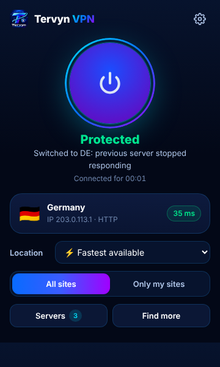
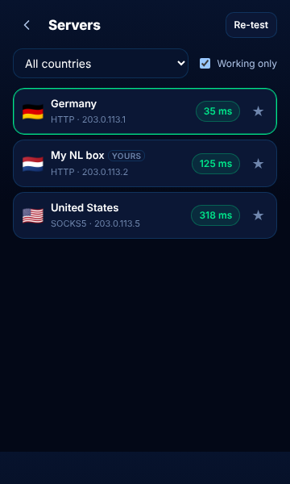
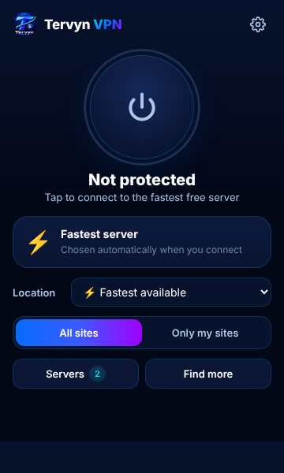
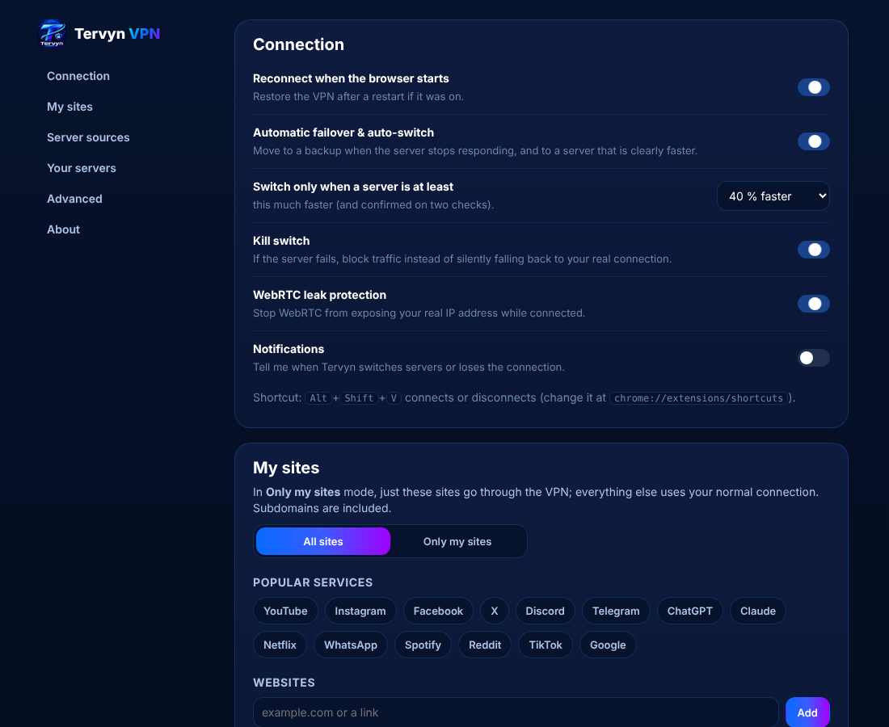

# Tervyn VPN — browser extension

The desktop companion of the [Tervyn VPN Android app](https://github.com/Fadi-yt1/tervynvpn): a free,
account-free VPN for **Chrome, Edge, Brave, Opera and other Chromium browsers** (Manifest V3).

| Connected | Servers | Not connected |
|---|---|---|
|  |  |  |



## Features

* **One-click connect** to the fastest *verified* server, or pick a country / a specific server.
* **Automatic failover and auto-switch.** The active server is checked every minute (and right away when the
  browser reports a proxy error). If it stops responding, Tervyn moves to the best backup. It also switches to a
  server that is at least 40 % faster (you can change this). The faster server must win two checks in a row,
  and Tervyn waits at least 5 minutes between switches. This is the same policy as the app.
* **Two routing modes**:
  * *All sites*: the whole browser goes through the VPN. Local network addresses and your bypass list stay direct.
  * *Only my sites*: only the domains you choose go through the VPN, plus the same presets as the app
    (YouTube, Instagram, X, Discord, Telegram including its IP ranges, ChatGPT, Claude, Netflix…).
    Add the current site from the popup, or right-click a page → *Route this site through Tervyn*.
* **Server sources**:
  * the same 18 public free-proxy lists as the app, plus any `.txt` list you add
  * Proxio.io (API key)
  * your own HTTP(S)/SOCKS5 servers: paste them or import a `.txt` file. Formats: `host:port`,
    `host:port:user:pass`, `user:pass@host:port`, `socks5://…`, `http://…`.
* **Verified servers only.** A server is used only after it passes an HTTPS request to Cloudflare's
  `/cdn-cgi/trace`, made *through* the proxy. The browser validates the real certificate. The exit IP and
  country come from that trace and are never guessed. A proxy that leaks your real IP is rejected.
* **Leak protection**:
  * a kill switch: if the server fails, traffic is blocked instead of falling back to your real connection
  * WebRTC IP-leak protection while connected
* **Extras**: a badge with the exit country, notifications on failover, the keyboard shortcut
  <kbd>Alt</kbd>+<kbd>Shift</kbd>+<kbd>V</kbd>, favorites, backup/restore, and a local activity history.
  There are no accounts, ads or telemetry.

### Differences from the Android app

A browser extension can only steer the browser's own traffic, through the browser proxy API. So:

* It protects **this browser only**, not other apps on the computer.
* **VLESS / VMess / Trojan / Shadowsocks** links need the app's Xray engine, so the extension can't use them.
  When you import them, it counts and skips them.
* Chromium can't send a username/password to **SOCKS5** proxies. Use an HTTP proxy for servers that need a
  login (HTTP proxy authentication is supported).

## Install (developer mode)

1. Download or clone this repository. Alternatively, run `npm run build` and unzip `dist/tervyn-vpn-<version>.zip`.
2. Open `chrome://extensions` (Edge: `edge://extensions`) and turn on **Developer mode**.
3. Click **Load unpacked** and select the folder that contains `manifest.json`.
4. Pin Tervyn VPN to the toolbar and click the power button.

The first connection downloads the proxy lists and tests the servers. On free servers this usually takes 10–60 s.
Later connections reuse servers that were already verified.

To publish to the store, upload the zip from `npm run build` to the Chrome Web Store / Edge Add-ons dashboard.

## How it works

```
src/
  background.js        service worker: events, messages, context menu, shortcut, alarms
  bg/manager.js        discovery, testing, ranking, connect / failover / auto-switch
  bg/controller.js     PAC script application, proxy authentication, WebRTC policy
  bg/store.js          chrome.storage schema and defaults
  lib/                 pure logic shared with the UI (ports of the app's Kotlin code):
                       proxyList, domains (+ presets), pac, ranking, trace, proxio, sources, format
  popup/               toolbar popup (connect, location, mode, server list)
  options/             full settings page
```

All routing goes through one generated **PAC script**:

* the active server for every site (or only for your sites)
* DIRECT for local names, private networks and your bypass list
* a few **test slots**

**How servers are tested.** To test a proxy, the PAC script routes a single Cloudflare trace host (for example
`1.1.1.1`) through that proxy. The extension then fetches `https://1.1.1.1/cdn-cgi/trace`. With 16 trace hosts,
16 proxies are tested in parallel, and your normal browsing is not affected.

**Calibration.** First, the extension fetches every trace host directly. This finds the hosts that work on your
network and records your real IP, so a "test" that bypassed the proxy is never counted as a working server.

## Development

```bash
npm test             # unit tests (parsers, PAC routing, ranking/auto-switch policy, Proxio, domains)
```

```bash
npm run test:e2e     # loads the extension into Chromium and drives it against local mock proxies
```

```bash
npm run build        # dist/tervyn-vpn-<version>.zip
```

The end-to-end test needs Playwright (`npm i -D playwright && npx playwright install chromium`).
It starts local HTTP and SOCKS5 proxies:

* one fast proxy
* one slow proxy
* one dead proxy
* one that needs a password
* one that leaks the real IP

It then checks:

* calibration, list download and parsing
* that the fastest server is chosen and the bad proxies are rejected
* proxy authentication
* both routing modes
* failover when the active server dies
* that disconnecting restores the direct connection

No Internet access is needed.

## Privacy & safety

Everything stays in your browser: settings, servers, history and your Proxio key. Free public proxies are run by
unknown third parties. Sites you open over HTTPS stay end-to-end encrypted, but the proxy operator can see which
sites you visit. Don't rely on free servers for sensitive accounts.
